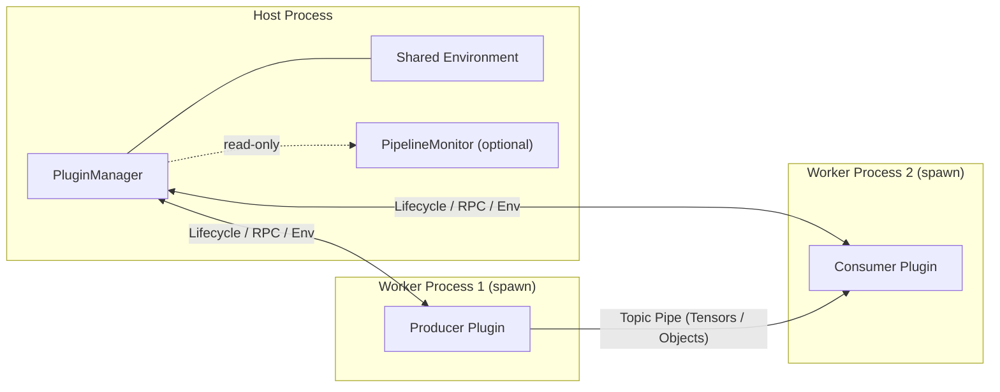

<div align="center">


# parallelazy

**Lightweight multiprocess plugin pipelines for Python — spawn-isolated workers, pipe-backed pub/sub, shared environment, RPC, and PyTorch/CUDA-aware IPC.**

[](https://pypi.org/project/parallelazy/)
[](https://pypi.org/project/parallelazy/)
[](https://pypi.org/project/parallelazy/)
[](https://github.com/cesare-montresor/parallelazy/blob/main/examples/example_cuda_zero_copy.py)
[](https://marketplace.visualstudio.com/items?itemName=CesareMontresor.parallelazy-vscode)
[](https://github.com/cesare-montresor/parallelazy/blob/main/LICENSE)

[Features](#features) · [Installation](#installation) · [Quick Start](#quick-start) · [Monitoring](#pipeline-monitoring) · [VS Code Debugging](#debugging-in-vs-code) · [AI Agents](#using-with-ai-agents) · [Examples](#examples) · [Docs](https://github.com/cesare-montresor/parallelazy/blob/main/docs/index.md)

</div>

---

## Why `parallelazy`?

Building multi-process Python pipelines—especially for ML, computer vision, and PyTorch/CUDA workloads—usually means writing boilerplate around `multiprocessing.Queue`, wrestling with shutdown races, debugging broken `spawn` workers, and tracking down tensor IPC leaks.

**`parallelazy`** gives you a clean, zero-broker plugin architecture built on `torch.multiprocessing` (`spawn`). Each stage runs in its own isolated OS process with deterministic lifecycle hooks, direct pipe-backed pub/sub, a shared reactive environment, plugin-to-plugin RPC, and built-in observability.

## Features

| | Capability | Details |
| :-: | :--- | :--- |
| 🧩 | **Spawn-Isolated Plugins** | Separate `load` → `start` → `stop` → `unload` lifecycle, parallel plugin loading, cooperative `wait_for_stop()`, and JSON-serializable `Plugin.Descriptor`s. |
| 📡 | **Live Topic Pub/Sub** | Direct per-subscriber pipe-backed fan-out queues with strict pipe ownership and no external message broker. |
| 🌍 | **Shared Environment** | Manager-owned key/value store with FIFO `env_subscribe()` notifications (initial value delivered before updates) and `None`-safe `env_get()`. |
| ⚡ | **Plugin-to-Plugin RPC** | Synchronous and async (`wait=False`) method calls between plugins, plus dynamic plugin orchestration from supervisor workers. |
| 🔥 | **PyTorch & CUDA-Aware IPC** | Automatic recursive `sanitize_for_ipc()`, compiled/CUDA-graph output marking (`mark_graph_output()`), and managed CUDA event pools (`IpcEventPoolManaged`). |
| 📊 | **Read-Only Pipeline Monitor** | Inspect pending topic pipe bytes (`FIONREAD`), CPU/RAM usage (`psutil`), and NVIDIA GPU metrics (`nvidia-ml-py`) without reading payloads. |
| 📝 | **Correlated Run Logging** | Manager and worker logs share a single run ID with configurable `work_dir`/`log_dir`, or silent `write_logs=False` for tests. |
| 🐛 | **VS Code Spawn Debugging** | Auto-attach `debugpy` to spawned worker processes via the companion [parallelazy-vscode](https://marketplace.visualstudio.com/items?itemName=CesareMontresor.parallelazy-vscode) extension. |
| 🤖 | **AI Agent Ready** | Ships an embedded Agent Skill (`SKILL.md`) inside the wheel for coding assistants. |

## Architecture at a Glance



## Installation

Requires **Python 3.11+**, **PyTorch**, and **NumPy**.

```bash
pip install parallelazy
```

To enable CPU, memory, and NVIDIA GPU metrics in the built-in pipeline monitor:

```bash
pip install "parallelazy[monitoring]"
```

For local development from source:

```bash
git clone https://github.com/cesare-montresor/parallelazy.git
cd parallelazy
pip install -e ".[monitoring]"
```

## Quick Start

```python
import time
from parallelazy import Plugin, PluginManager


class Worker(Plugin):
    @classmethod
    def default_options(cls) -> dict:
        return {"greeting": "hello"}

    def on_start(self):
        self.topic_subscribe("jobs", self.on_job)
        self.env_set("worker.ready", True)

    def on_job(self, payload):
        self.logger.info("%s: %s", self.options["greeting"], payload)

    def main(self):
        # Return immediately for event-driven plugins, or loop cooperatively
        # with `while not self.wait_for_stop(timeout=0.5): ...`
        pass

    def on_stop(self):
        self.env_set("worker.ready", False)


def main():
    with PluginManager() as manager:
        descriptor = Worker.Descriptor(
            version="1.0.0",
            author="Application team",
            description="Example worker",
            options={"greeting": "hi"},
        )
        if not manager.load_plugin(descriptor):
            raise RuntimeError(f"Failed to load {descriptor.name}")
        if not manager.start_plugin(descriptor.name):
            raise RuntimeError(f"Failed to start {descriptor.name}")

        time.sleep(0.1)
        print("Worker ready:", manager.env_get("worker.ready"))
        manager.topic_publish("jobs", {"task_id": 1})


if __name__ == "__main__":
    main()
```

> **Note:** Because `parallelazy` uses the `spawn` start method, always guard application startup with `if __name__ == "__main__":` and keep `Plugin` subclasses at module top level in an importable module (run scripts as `python -m your_package.module`).

## Communication & IPC Primitives

<details>
<summary><b>📡 Topic Pub/Sub</b> — live pipe-backed fan-out</summary>

```python
# Inside a subscriber plugin (register in on_start so early messages aren't missed)
self.topic_subscribe("frames", self.on_frame)

# Inside a publisher plugin or from PluginManager
self.topic_publish("frames", {"tensor": frame_tensor, "seq": 42})
```

</details>

<details>
<summary><b>🌍 Shared Environment</b> — manager-owned reactive state</summary>

```python
# Set a value from any plugin or the manager
self.env_set("model.threshold", 0.75)

# Read a value (distinguishes stored None from unset keys)
threshold = self.env_get("model.threshold", default=0.5)

# React to changes in FIFO order (initial value delivered first)
self.env_subscribe("model.threshold", self.on_threshold_change)
```

</details>

<details>
<summary><b>⚡ Plugin RPC & Dynamic Orchestration</b> — sync or async calls</summary>

```python
# Synchronous RPC
result = self.plugin_call("feature-extractor", "infer", batch)

# Asynchronous RPC (returns a PendingRequest)
req = self.plugin_call("feature-extractor", "infer", batch, wait=False)
result = req.wait(timeout=5.0)
```

</details>

<details>
<summary><b>🔥 PyTorch & CUDA IPC</b> — safe tensor transfer & zero-copy pools</summary>

- Plain Python objects, nested containers, NumPy arrays, and PyTorch CPU/CUDA tensors work natively across topics, environment values, and RPC.
- `sanitize_for_ipc()` automatically clones IPC-received or graph-pooled tensors before re-sharing.
- Wrap outputs from `torch.compile` or CUDA graphs with `mark_graph_output(tensor)` before publishing or returning them.
- Use `IpcEventPoolManaged` for zero-copy CUDA tensor streaming with cross-process synchronization (see [`example_cuda_zero_copy.py`](https://github.com/cesare-montresor/parallelazy/blob/main/examples/example_cuda_zero_copy.py)).

</details>

## Pipeline Monitoring

Enable an optional, read-only view of topic backlog, plugin process resources, and shared environment activity:

```python
manager.enable_monitoring(sample_interval=1.0)
snapshot = manager.get_monitoring_snapshot()
manager.print_monitoring_report()
manager.disable_monitoring()
```

- **Zero payload intrusion:** the monitor never reads or mutates topic messages; topic backlog is measured as pending pipe bytes (`FIONREAD`).
- **Process & GPU telemetry:** uses `psutil` for CPU/RAM and `nvidia-ml-py` for NVIDIA GPUs when installed via `pip install "parallelazy[monitoring]"`, and clearly reports any missing optional dependency.

## Debugging in VS Code

Because `debugpy` does not automatically attach to `spawn`-started subprocesses, `parallelazy` pairs with a lightweight companion VS Code extension:

- **Marketplace:** [CesareMontresor.parallelazy-vscode](https://marketplace.visualstudio.com/items?itemName=CesareMontresor.parallelazy-vscode)
- **How it works:** when running under the VS Code debugger, spawned workers reuse VS Code's `debugpy` path and notify the extension to attach automatically—no separately pinned `debugpy` dependency required.
- Ready-to-use launch configurations for all examples are included in [`.vscode/launch.json`](https://github.com/cesare-montresor/parallelazy/blob/main/.vscode/launch.json).

## Using with AI Agents

`parallelazy` bundles a concise Agent Skill / usage guide (`parallelazy/SKILL.md`) right inside the wheel so coding agents immediately follow lifecycle, concurrency, and CUDA IPC best practices:

```bash
# Print the embedded usage guide (or pass --path for the installed file path)
python -m parallelazy agent-guide

# Install as a local Agent Skill (.agents/skills/parallelazy/SKILL.md by default)
python -m parallelazy install-skill
```

## Examples

All runnable examples live in [`examples/`](https://github.com/cesare-montresor/parallelazy/tree/main/examples) and can be executed from the repository root with `python -m`:

| Example | Command | What It Demonstrates |
| :--- | :--- | :--- |
| **Quickstart** | `python -m examples.example_quickstart` | Lifecycle hooks, `work_dir`, custom log formats, cooperative `wait_for_stop()` |
| **Tensor Pipeline** | `python -m examples.example_tensor_pipeline` | 3-stage PyTorch pub/sub pipeline, parallel loading, live monitoring |
| **Live Config** | `python -m examples.example_live_config` | Shared environment flags, `None` vs unset keys, FIFO `env_subscribe` |
| **Dynamic Orchestrator** | `python -m examples.example_dynamic_orchestrator` | Supervisor plugin spawning workers dynamically with async RPC sharding |
| **Resilience & Errors** | `python -m examples.example_resilience_and_errors` | `on_error()`, `PluginState.ERROR`, `plugin_errors()`, retries & reload recovery |
| **CUDA Zero-Copy** | `python -m examples.example_cuda_zero_copy` | Zero-copy CUDA streaming with `IpcEventPoolManaged` and `mark_graph_output()` |

## Documentation

| Guide | Description |
| :--- | :--- |
| [Documentation Index](https://github.com/cesare-montresor/parallelazy/blob/main/docs/index.md) | Overview and navigation for all guides |
| [Getting Started](https://github.com/cesare-montresor/parallelazy/blob/main/docs/getting-started.md) | Installation, first plugin, and setup checklist |
| [Core Concepts & Lifecycle](https://github.com/cesare-montresor/parallelazy/blob/main/docs/concepts.md) | Process model, threading, shutdown ordering, and IPC semantics |
| [API Reference](https://github.com/cesare-montresor/parallelazy/blob/main/docs/api.md) | Complete `Plugin`, `PluginManager`, IPC, and monitoring contracts |
| [Examples & Patterns](https://github.com/cesare-montresor/parallelazy/blob/main/docs/examples.md) | Walkthroughs of the bundled end-to-end pipelines |
| [Troubleshooting](https://github.com/cesare-montresor/parallelazy/blob/main/docs/troubleshooting.md) | Common `spawn`, shutdown, logging, and CUDA IPC pitfalls |
| [Pipeline Monitor Analysis](https://github.com/cesare-montresor/parallelazy/blob/main/docs/monitoring_tool_analysys.md) | Design and metrics reference for `PipelineMonitor` |

## Development & Testing

```bash
# Run the test suite (CUDA IPC tests skip automatically on CPU-only hosts)
python -m unittest discover -s tests

# Build sdist and wheel distributions
python -m build
```

## License

Distributed under the **GNU General Public License v2.0** — see [LICENSE](https://github.com/cesare-montresor/parallelazy/blob/main/LICENSE) for details. Created by [Cesare Montresor](https://github.com/cesare-montresor).
